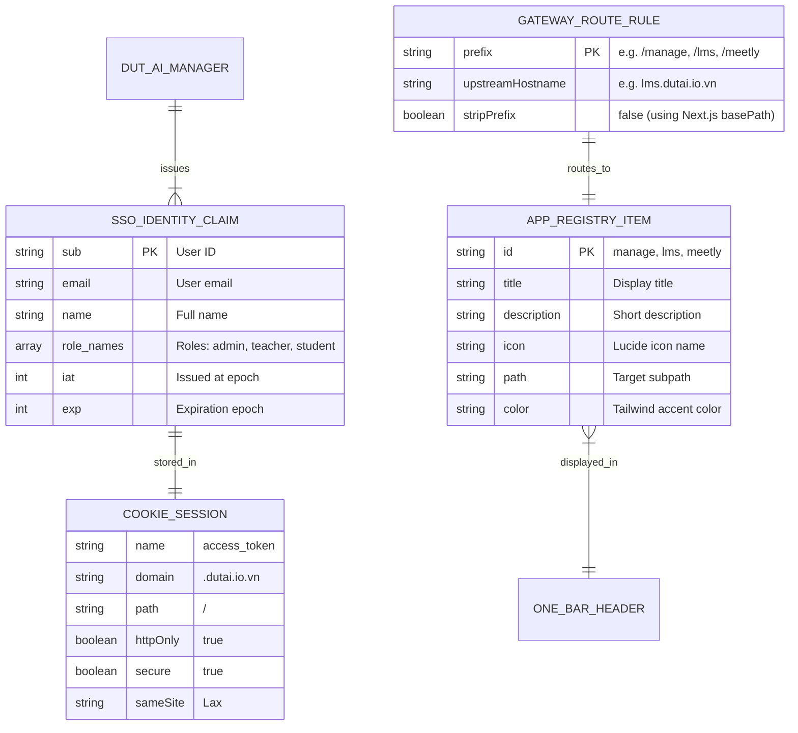

# Phase 1 Data Model: True SSO & Multi-Zones Gateway

**Branch**: `001-unified-app-portal` | **Date**: 2026-11-20 | **Feature Spec**: [spec.md](file:///Users/nguyenhuynh/Documents/projects/DUT-AI-workspace/specs/001-unified-app-portal/spec.md)

---

## 1. Entity Overview



---

## 2. Entities & Schemas

### 2.1 `SSOIdentityClaim` (JWT Payload)

The unified JWT token issued by `dut-ai-manager` and verified by all sub-applications:

| Field | Type | Required | Description | Example |
|-------|------|----------|-------------|---------|
| `sub` | `string` | Yes | Subject identifier (User UUID/ID) | `"1042"` |
| `email` | `string` | Yes | User email address | `"admin@dut.udn.vn"` |
| `name` | `string` | Yes | User display name | `"Nguyễn Văn A"` |
| `role_names` | `string[]` | Yes | Assigned permission roles | `["admin", "teacher"]` |
| `iat` | `number` | Yes | Token issue timestamp | `1732060000` |
| `exp` | `number` | Yes | Token expiration timestamp (e.g. 7 days) | `1732664800` |

#### TypeScript Interface:
```typescript
export interface SSOIdentityClaim {
  sub: string;
  email: string;
  name: string;
  role_names: string[];
  iat: number;
  exp: number;
}
```

---

### 2.2 `AppRegistryItem` (9-Dots App Launcher)

Defines each application available inside the Google-style Waffle menu:

| Field | Type | Description |
|-------|------|-------------|
| `id` | `string` | App unique identifier (`'manage'`, `'lms'`, `'meetly'`) |
| `title` | `string` | Display name (e.g. `"Hệ thống Quản lý"`) |
| `description` | `string` | Subtitle description |
| `icon` | `string` | Lucide icon name |
| `path` | `string` | Path on `workspace.dutai.io.vn` (e.g. `"/manage/dashboard"`) |
| `accentColor` | `string` | Color style for icon background |

#### Configuration Registry:
```typescript
export const WORKSPACE_APPS: AppRegistryItem[] = [
  {
    id: 'manage',
    title: 'Hệ thống Quản lý',
    description: 'Bảng điều khiển quản trị tập trung DUT-AI',
    icon: 'LayoutDashboard',
    path: '/manage/dashboard',
    accentColor: 'bg-blue-600',
  },
  {
    id: 'lms',
    title: 'Học tập & Đề thi (LMS)',
    description: 'Trắc nghiệm, bài giảng & kiểm tra kiến thức',
    icon: 'GraduationCap',
    path: '/lms/dashboard',
    accentColor: 'bg-emerald-600',
  },
  {
    id: 'meetly',
    title: 'Công việc & Lịch họp (Meetly)',
    description: 'Quản lý task, sự kiện & dự án đội ngũ',
    icon: 'CalendarCheck',
    path: '/meetly/tasks',
    accentColor: 'bg-indigo-600',
  },
];
```

---

### 2.3 `GatewayRouteRule` (Cloudflare Worker Route Map)

Defines how Cloudflare Edge maps incoming subpaths to the destination VPS tunnels:

```typescript
export interface GatewayRouteRule {
  prefix: string;
  targetHostname: string;
  defaultRedirectPath?: string;
}

export const GATEWAY_ROUTES: GatewayRouteRule[] = [
  {
    prefix: '/manage',
    targetHostname: 'manage.dutai.io.vn',
    defaultRedirectPath: '/manage/dashboard',
  },
  {
    prefix: '/lms',
    targetHostname: 'lms.dutai.io.vn',
    defaultRedirectPath: '/lms/dashboard',
  },
  {
    prefix: '/meetly',
    targetHostname: 'meetly.dutai.io.vn',
    defaultRedirectPath: '/meetly/tasks',
  },
];
```
