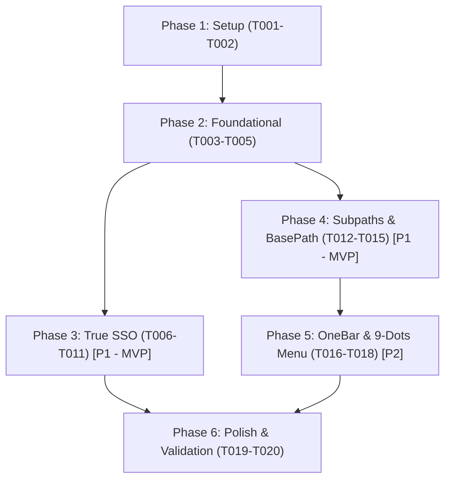

# Tasks: DUT-AI Unified Workspace & True Single Sign-On (SSO)

**Input**: Design documents from `/specs/001-unified-app-portal/`
**Prerequisites**: [plan.md](file:///Users/nguyenhuynh/Documents/projects/DUT-AI-workspace/specs/001-unified-app-portal/plan.md), [spec.md](file:///Users/nguyenhuynh/Documents/projects/DUT-AI-workspace/specs/001-unified-app-portal/spec.md), [research.md](file:///Users/nguyenhuynh/Documents/projects/DUT-AI-workspace/specs/001-unified-app-portal/research.md), [data-model.md](file:///Users/nguyenhuynh/Documents/projects/DUT-AI-workspace/specs/001-unified-app-portal/data-model.md), [contracts/](file:///Users/nguyenhuynh/Documents/projects/DUT-AI-workspace/specs/001-unified-app-portal/contracts/)

**Organization**: Tasks are grouped by user story to enable independent implementation and testing of each story.

## Format: `[ID] [P?] [Story] Description`

- **[P]**: Can run in parallel (different files, no dependencies)
- **[Story]**: Which user story this task belongs to (e.g., US1, US2, US3)
- Include exact file paths in descriptions

---

## Phase 1: Setup (Shared Infrastructure & Environment)

**Purpose**: Establish synchronized environment variables and repository configuration across the ecosystem.

- [X] T001 Synchronize `SHARED_JWT_SECRET` and `COOKIE_DOMAIN=.dutai.io.vn` across `.env` files in `dut-ai-manager/backend/.env`, `dut-ai-quiz/apps/api/.env`, and `meetly/core/.env`
- [X] T002 [P] Configure Cloudflare Worker project directory and configuration in `cloudflare/wrangler.toml` targeting `workspace.dutai.io.vn`

---

## Phase 2: Foundational (Blocking Prerequisites)

**Purpose**: Core gateway script and shared data types required before implementing user stories.

**⚠️ CRITICAL**: No user story work can begin until this phase is complete.

- [X] T003 [P] Implement Cloudflare Worker Edge Gateway routing script in `cloudflare/worker.js` based on `specs/001-unified-app-portal/contracts/cloudflare-worker-gateway.js` supporting subpaths `/manage`, `/lms`, `/meetly` and WebSocket proxying
- [X] T004 [P] Create unified TypeScript types for `SSOIdentityClaim` (fields: `sub` string, `email` string, `name` string, `role_names` string[], `iat` int, `exp` int) in `src/types/sso.ts`
- [X] T005 [P] Create shared app registry configuration (`WORKSPACE_APPS`) with properties `id`, `title`, `description`, `icon`, `path`, `accentColor` in `src/config/apps.ts`

**Checkpoint**: Foundation ready - user story implementation can now begin in parallel.

---

## Phase 3: User Story 1 - True Single Sign-On & Global Session (Priority: P1) 🎯 MVP

**Goal**: Implement True SSO where `dut-ai-manager` acts as the central IdP issuing `access_token` with `Domain=.dutai.io.vn`, and `dut-ai-quiz` & `meetly` act as Resource Servers verifying JWT in-memory with zero remote HTTP calls.

**Independent Test**:
1. Log in at `https://workspace.dutai.io.vn/manage/login`.
2. Inspect cookie: `access_token` must have `domain=.dutai.io.vn; path=/; httponly=true; secure=true; samesite=lax`.
3. Open `https://workspace.dutai.io.vn/lms/dashboard` and `https://workspace.dutai.io.vn/meetly/tasks` directly; verify both recognize the user session instantly without secondary login.
4. Click Logout on any service; verify cookie is removed and all services redirect to `/login`.

### Implementation for User Story 1

- [X] T006 [US1] Update `dut-ai-manager` authentication controller in `/Users/nguyenhuynh/Documents/dut-ai-manager/backend/app/auth/controller.py` to set `access_token` and `refresh_token` cookies with constraints `domain=".dutai.io.vn"`, `path="/"`, `httponly=True`, `secure=True`, `samesite="lax"`
- [X] T007 [US1] Update `dut-ai-manager` logout handler in `/Users/nguyenhuynh/Documents/dut-ai-manager/backend/app/auth/controller.py` to delete `access_token` and `refresh_token` cookies with `domain=".dutai.io.vn"` and `path="/"`
- [X] T008 [P] [US1] Implement in-memory JWT decoder dependency in `/Users/nguyenhuynh/Documents/projects/dut-ai-quiz/apps/api/app/presentation/api/dependencies/auth.py` verifying `access_token` cookie against `SHARED_JWT_SECRET` and extracting claims (`sub`, `email`, `name`, `role_names`) without remote HTTP calls
- [X] T009 [US1] Update Quiz auth router in `/Users/nguyenhuynh/Documents/projects/dut-ai-quiz/apps/api/app/presentation/api/routers/auth.py` to eliminate local session token issuance (`self._sessions.create()`) and rely directly on the shared `access_token` cookie
- [X] T010 [P] [US1] Implement in-memory JWT verification dependency in `/Users/nguyenhuynh/Documents/projects/meetly/modules/identity/` and `/Users/nguyenhuynh/Documents/projects/meetly/core/config/auth.py` decoding `access_token` with `SHARED_JWT_SECRET` directly in RAM
- [X] T011 [US1] Update Next.js edge auth middleware in `/Users/nguyenhuynh/Documents/projects/dut-ai-quiz/apps/web/middleware.ts` and `/Users/nguyenhuynh/Documents/projects/meetly/web/src/middleware.ts` to inspect `access_token` and redirect unauthenticated requests to `/login?returnUrl=...`

**Checkpoint**: True SSO is fully functional. Users log in once and access all 3 sub-apps seamlessly.

---

## Phase 4: User Story 2 - Single Unified Domain Subpaths Without Iframe (Priority: P1) 🎯 MVP

**Goal**: Host all three applications under `https://workspace.dutai.io.vn/<tên_app>` as native web DOM (zero iframes) with partitioned `basePath` to prevent `_next/static` chunk collisions.

**Independent Test**:
1. Open `https://workspace.dutai.io.vn/lms/dashboard` and `https://workspace.dutai.io.vn/meetly/tasks`.
2. Inspect DOM: Verify 0 `<iframe>` tags present.
3. Inspect Network tab: Verify CSS/JS chunks load from `/lms/_next/static/...` and `/meetly/_next/static/...` with HTTP 200.
4. Verify native single scrollbar and responsive mobile layout.

### Implementation for User Story 2

- [X] T012 [P] [US2] Configure `basePath: '/lms'` and legacy root redirects (`/` -> `/lms/dashboard`) in `/Users/nguyenhuynh/Documents/projects/dut-ai-quiz/apps/web/next.config.mjs`
- [X] T013 [P] [US2] Configure `basePath: '/meetly'` and legacy root redirects (`/` -> `/meetly/tasks`) in `/Users/nguyenhuynh/Documents/projects/meetly/web/next.config.mjs`
- [X] T014 [P] [US2] Configure `basePath: '/manage'` and legacy root redirects (`/` -> `/manage/dashboard`) in `/Users/nguyenhuynh/Documents/dut-ai-manager/web/next.config.mjs`
- [X] T015 [US2] Deploy and test Cloudflare Worker on route `workspace.dutai.io.vn/*` using `cloudflare/worker.js`, validating subpath proxying to each upstream Cloudflare Tunnel

**Checkpoint**: All three applications load natively under `workspace.dutai.io.vn` with complete asset isolation.

---

## Phase 5: User Story 3 - Google-Style OneBar & 9-Dots App Launcher (Priority: P2)

**Goal**: Deliver a unified top navigation bar (`DutAiHeader`) with the 9-dots Waffle icon (`:::`) across all applications, providing the authentic Google Workspace user experience.

**Independent Test**:
1. Open any page under `workspace.dutai.io.vn`.
2. Click the 9-dots waffle icon (`:::`) in the header.
3. Verify popover displays Manage, LMS, and Meetly with correct icons and titles.
4. Click any app item; verify smooth navigation to that subpath while retaining the header.

### Implementation for User Story 3

- [X] T016 [P] [US3] Create `DutAiHeader` component in `src/components/common/DutAiHeader.tsx` featuring DUT-AI branding, 9-dots Waffle popover menu, notification bell, and user avatar with Logout action
- [X] T017 [US3] Integrate `DutAiHeader` into DUT-AI Quiz global layout in `/Users/nguyenhuynh/Documents/projects/dut-ai-quiz/apps/web/app/(root)/layout.tsx`
- [X] T018 [US3] Integrate `DutAiHeader` into Meetly dashboard layout in `/Users/nguyenhuynh/Documents/projects/meetly/web/src/app/(dashboard)/layout.tsx`

**Checkpoint**: All applications share an identical top OneBar with 9-dots Waffle App Launcher.

---

## Phase 6: Polish & Cross-Cutting Concerns

**Purpose**: High availability resilience, edge fallbacks, and end-to-end verification.

- [X] T019 [P] Implement custom branded fallback error pages (HTTP 502/503) in `cloudflare/worker.js` with quick-nav links when an individual VPS tunnel is unreachable
- [X] T020 Run end-to-end validation scenarios documented in [quickstart.md](file:///Users/nguyenhuynh/Documents/projects/DUT-AI-workspace/specs/001-unified-app-portal/quickstart.md) and verify all acceptance criteria

---

## Dependencies & Execution Order

### Phase Dependencies

- **Setup (Phase 1)**: Can start immediately.
- **Foundational (Phase 2)**: Depends on Setup (T001, T002) - BLOCKS all user stories.
- **User Story 1 (Phase 3 - P1)**: Depends on Foundational (Phase 2).
- **User Story 2 (Phase 4 - P1)**: Depends on Foundational (Phase 2). Can execute in parallel with US1.
- **User Story 3 (Phase 5 - P2)**: Depends on US2 completion (subpaths active).
- **Polish (Phase 6)**: Depends on all user stories completed.

---

## Parallel Opportunities

- **Phase 1**: T001 and T002 can run in parallel.
- **Phase 2**: T003, T004, and T005 can all run in parallel.
- **Phase 3 (US1)**:
  - T006 and T007 (Manager IdP) can run in parallel with T008 (Quiz) and T010 (Meetly).
- **Phase 4 (US2)**:
  - T012 (`dut-ai-quiz`), T013 (`meetly`), and T014 (`dut-ai-manager`) can run simultaneously as they edit different repository configs.
- **Phase 5 (US3)**:
  - T016 can be built first, then T017 and T018 can be integrated in parallel.

---

## Implementation Strategy

### MVP Scope (Phases 1, 2, 3 & 4)
- Complete Phase 1 (Environment setup) & Phase 2 (Gateway foundation).
- Implement Phase 3 (True SSO): Login once at Manager, shared cookie, in-memory validation in Quiz & Meetly.
- Implement Phase 4 (Subpaths): Configure `basePath` in Quiz & Meetly, route through Cloudflare Worker.
- **Validate MVP**: Access `workspace.dutai.io.vn/lms` and `workspace.dutai.io.vn/meetly` without re-login and with native DOM (zero iframes).

### Incremental Delivery (Phase 5 & 6)
- Add Phase 5 (OneBar + 9-dots menu) to tie together the visual Google Workspace identity.
- Add Phase 6 (Edge fallback error screens & E2E smoke tests).
