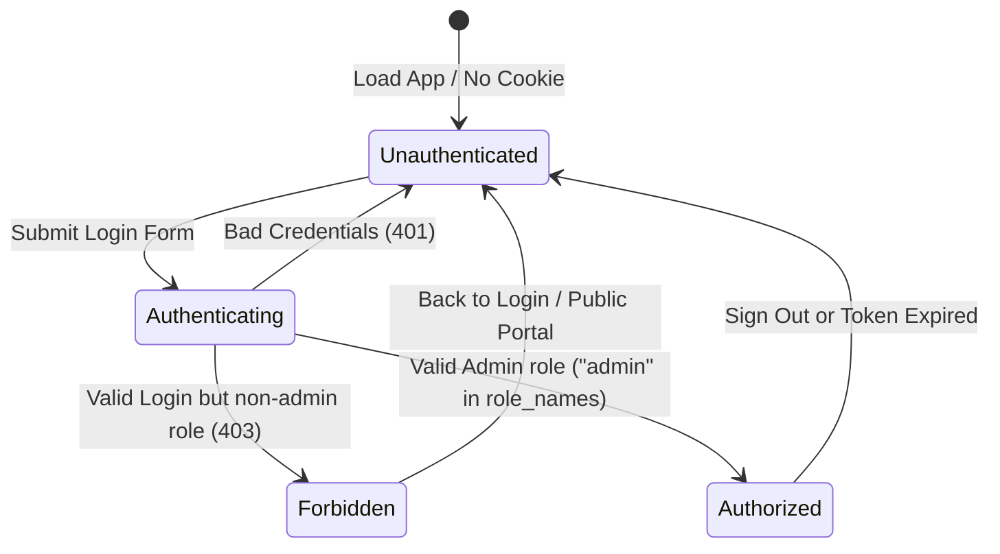

# Data Model: Admin Login and Role-Based Access Control (RBAC)

**Feature**: `002-admin-login-rbac` | **Spec**: [spec.md](file:///Users/nguyenhuynh/Documents/projects/DUT-AI-workspace/specs/002-admin-login-rbac/spec.md)

## Entities & Type Definitions

### 1. `AuthCredentials` (Login Payload)
Encapsulates credentials submitted by the user on the login interface.

| Field | Type | Validation Rules | Description |
|---|---|---|---|
| `email` | `string` | Required, valid email format | Registered user email address |
| `password` | `string` | Required, minimum 1 character | Account secret password |

```typescript
export interface AuthCredentials {
  email: string;
  password: string;
}
```

---

### 2. `AdminUserProfile` (Identity & Roles)
Returned by `GET https://manage.dutai.io.vn/api/v1/auth/me`. Represents the current authenticated user's profile and permissions.

| Field | Type | Description |
|---|---|---|
| `id` | `number` | Unique user identifier |
| `name` | `string` | Full display name (e.g. "Huỳnh Phước Nguyên") |
| `email` | `string` | User primary email address |
| `status` | `string` | Account status (e.g. "ACTIVE", "INACTIVE", "SUSPENDED") |
| `is_deleted` | `boolean` | Soft-deletion flag |
| `avatar_url` | `string \| null` | URL to user's profile avatar |
| `zalo_bot_id` | `string \| null` | Associated Zalo bot identifier |
| `role_names` | `string[]` | Assigned system roles (e.g. `["admin", "Trainer"]`) |
| `permissions` | `string[]` | Granted granular permission keys |

```typescript
export interface AdminUserProfile {
  id: number;
  name: string;
  email: string;
  status: string;
  is_deleted: boolean;
  avatar_url: string | null;
  zalo_bot_id: string | null;
  role_names: string[];
  permissions: string[];
}
```

---

### 3. `AuthApiResponse<T>`
Standard envelope returned by all `manage.dutai.io.vn` API endpoints.

| Field | Type | Description |
|---|---|---|
| `is_success` | `boolean` | Indicates whether operation succeeded |
| `status_code` | `number` | HTTP status code (200, 401, 403, 500) |
| `message` | `string` | Human-readable response message in Vietnamese or English |
| `data` | `T \| null` | Payload data or null on failure |
| `pagination` | `any \| null` | Optional pagination details |

```typescript
export interface AuthApiResponse<T> {
  is_success: boolean;
  status_code: number;
  message: string;
  data: T | null;
  pagination: unknown | null;
}
```

---

### 4. `AuthTokenData` (Token Response)
Payload returned inside `data` upon successful `POST /api/v1/auth/login`.

| Field | Type | Description |
|---|---|---|
| `access_token` | `string` | JWT access token |
| `refresh_token` | `string` | JWT refresh token |
| `token_type` | `string` | Token type (e.g. `"bearer"`) |

```typescript
export interface AuthTokenData {
  access_token: string;
  refresh_token: string;
  token_type: string;
}
```

---

### 5. `AdminSessionState` (Client Auth Context)
State managed in the frontend client context to track authentication and RBAC authorization.

| Field | Type | Description |
|---|---|---|
| `user` | `AdminUserProfile \| null` | Hydrated user profile when authorized |
| `status` | `'loading' \| 'authenticated' \| 'unauthenticated' \| 'forbidden'` | Current authentication lifecycle state |
| `error` | `string \| null` | Localized error message to display |
| `isAdmin` | `boolean` | Derived boolean indicating whether user has role `admin` |

---

## State Transitions


