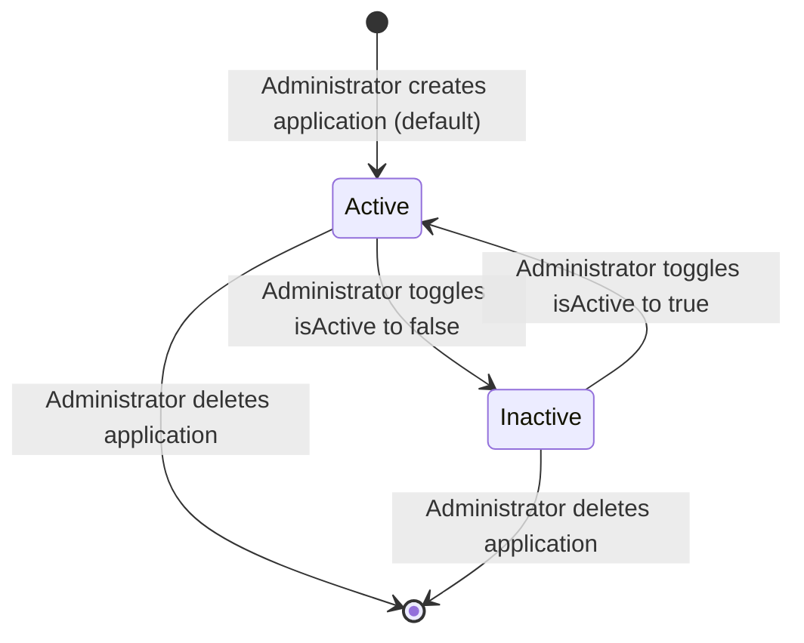

# Data Model: Ecosystem Application CRUD Management

**Feature**: `003-app-crud-management` | **Spec**: [spec.md](file:///Users/nguyenhuynh/Documents/projects/DUT-AI-workspace/specs/003-app-crud-management/spec.md)

## Entities & Type Definitions

### 1. `AppRegistryItem`
The persistent model representing a registered ecosystem website or application.

| Field | Type | Validation Rules | Description |
|---|---|---|---|
| `id` | `string` | Required, unique, regex: `^[a-z0-9-]+$`, length: 2-32 | Unique slug identifier (e.g. `"manage"`, `"lms"`, `"meetly"`, `"data"`) |
| `title` | `string` | Required, non-empty, max: 100 chars | Display title (e.g. `"DUT-AI LMS"`) |
| `shortName` | `string` | Optional, max: 50 chars | Condensed name for badges/headers (e.g. `"LMS"`) |
| `description` | `string` | Required, max: 500 chars | Narrative overview of capabilities |
| `icon` | `string` | Required, non-empty | Lucide icon identifier (e.g. `"LayoutDashboard"`, `"Database"`) |
| `url` | `string` | Required, valid URL starting with `http://` or `https://` | Full destination web address |
| `path` | `string` | Optional, defaults to `url` | Relative or canonical path |
| `badge` | `string` | Optional, max: 40 chars | Category tag (e.g. `"Quản trị"`, `"Đào tạo"`) |
| `tags` | `string[]` | Optional array of strings | Keywords for search and filtering |
| `accentColor` | `string` | Required, valid CSS color or Tailwind class | Brand color representation |
| `order` | `number` | Required integer $\ge 0$ | Display ordering weight (lower numbers first) |
| `isActive` | `boolean` | Required boolean, default: `true` | Visibility toggle for public hub and waffle menu |

```typescript
export interface AppRegistryItem {
  id: string;
  title: string;
  shortName?: string;
  description: string;
  icon: string;
  url: string;
  path?: string;
  badge?: string;
  tags?: string[];
  accentColor: string;
  order: number;
  isActive: boolean;
}
```

---

### 2. `CreateAppDto`
Payload submitted by an administrator to create a new application.

```typescript
export interface CreateAppDto {
  id: string;
  title: string;
  shortName?: string;
  description: string;
  icon: string;
  url: string;
  badge?: string;
  tags?: string[];
  accentColor?: string;
  order?: number;
  isActive?: boolean;
}
```

---

### 3. `UpdateAppDto`
Payload submitted by an administrator to update an existing application.

```typescript
export interface UpdateAppDto {
  title?: string;
  shortName?: string;
  description?: string;
  icon?: string;
  url?: string;
  badge?: string;
  tags?: string[];
  accentColor?: string;
  order?: number;
  isActive?: boolean;
}
```

---

## State Transitions for Application Status



- When **Active**: Visible in public Portal Hub (`/`), returned by public `GET /api/v1/apps`, rendered in Waffle Menu (`waffle.js`).
- When **Inactive**: Excluded from public Portal Hub and Waffle Menu; visible only to administrators in `/admin/apps` with an "Inactive" status badge.
